# Menor Preço Saqua

Aplicativo híbrido desenvolvido na disciplina de Laboratório de Desenvolvimento de Aplicativos Híbridos.

O projeto vem sendo desenvolvido de forma incremental ao longo das aulas, aplicando conceitos de React Native, gerenciamento de estado, componentes reutilizáveis, listas e integração com APIs REST.

---

## Problema

Em Saquarema existem diversos mercados com preços competitivos e promoções diferentes. Muitas vezes, o consumidor precisa procurar em vários estabelecimentos para descobrir onde determinado produto está mais barato.

---

## Proposta

O **Menor Preço Saqua** busca facilitar a consulta e o compartilhamento de preços e promoções dos mercados de Saquarema, auxiliando os consumidores na busca por opções mais econômicas.

---

## Objetivo

Desenvolver um aplicativo híbrido que auxilie os consumidores a localizar e compartilhar os menores preços encontrados nos mercados de Saquarema.

---

## Público-alvo

Moradores e consumidores de Saquarema que desejam economizar nas compras realizadas em supermercados da região.

---

# Evolução do Projeto

## Aulas 2 e 3 — Proposta e Primeiro MVP

Nas primeiras etapas foi definida a ideia do aplicativo **Menor Preço Saqua**, partindo do problema da variação de preços e promoções entre os mercados de Saquarema.

Foi desenvolvido o primeiro MVP com uma tela para cadastro de produtos e preços.

### Funcionalidades

- Campo para informar o nome do produto;

- Campo para informar o preço encontrado;

- Cadastro de produto e preço;

- Cadastro de vários produtos;

- Exibição dos produtos cadastrados;

- Limpeza dos campos após o cadastro;

- Limpeza da lista de produtos;

- Validação dos campos obrigatórios;

- Mensagem de erro quando o usuário tenta cadastrar sem preencher os dados necessários.

### Prints da aplicação — Aulas 2 e 3

#### Tela inicial


#### Produtos cadastrados


#### Validação dos campos


---

## Aula 4 — Componentes, Estado e Listas

Na Aula 4, o projeto foi aprimorado com a aplicação de conceitos importantes do React Native.

O cadastro de produtos passou a utilizar gerenciamento de estado e uma lista dinâmica para apresentar os itens cadastrados.

### Funcionalidades e conceitos aplicados

- Utilização do `useState`;

- Utilização de `TextInput`;

- Botões funcionais;

- Validação de campos vazios;

- Cadastro temporário dos produtos em memória;

- Utilização de `FlatList`;

- Exibição dinâmica dos produtos cadastrados;

- Remoção individual de produtos;

- Criação de componente reutilizável;

- Organização do projeto em componentes, telas e serviços.

### Organização utilizada

```

src/

├── components/

│   └── ProdutoItem.tsx

├── screens/

│   └── CadastroProdutoScreen.tsx

└── services/

```

O componente `ProdutoItem` ficou responsável pela apresentação de cada produto da lista e pela opção de removê-lo.

### Prints da aplicação — Aula 4

#### Cadastro de vários produtos

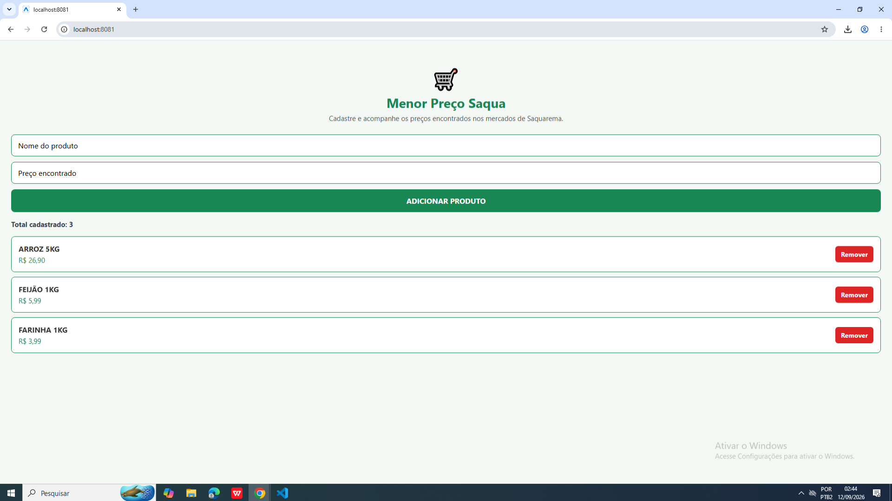

#### Remoção de produtos

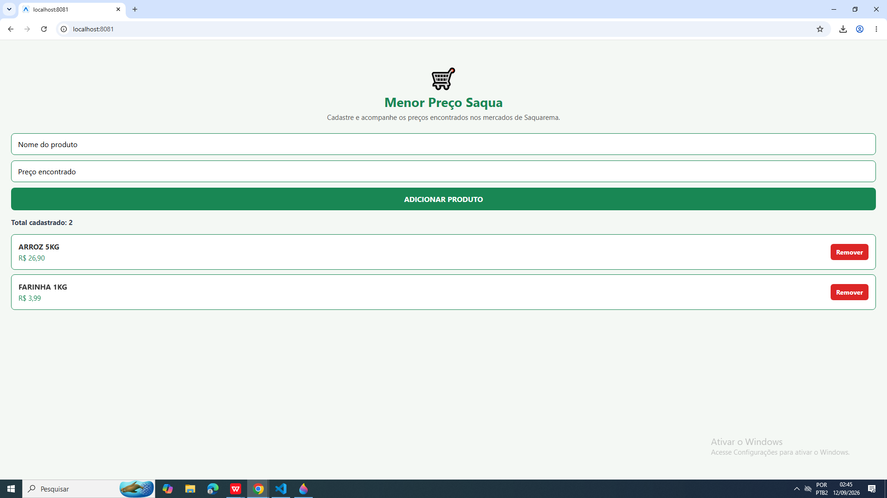

---

## Aula 5 — Integração com API REST

Na Aula 5, o aplicativo passou a consumir uma API REST pública, permitindo utilizar informações externas dentro da aplicação.

A API escolhida foi a **ViaCEP**, pois a consulta de endereço possui relação direta com a proposta do Menor Preço Saqua.

O usuário informa o CEP do mercado onde encontrou determinado preço e o aplicativo realiza uma consulta para localizar automaticamente o endereço.

### API utilizada

**ViaCEP**

A API é utilizada para consultar informações de endereço a partir do CEP informado pelo usuário.

### Funcionalidades implementadas

- Campo para informar o CEP do mercado;

- Consulta de CEP;

- Requisição HTTP utilizando o método `GET`;

- Consumo de API REST pública;

- Utilização de `fetch`;

- Processamento da resposta em formato JSON;

- Exibição do endereço retornado pela API;

- Validação do CEP informado;

- Indicador de carregamento durante a consulta;

- Tratamento de erros durante a consulta;

- Mensagens de sucesso e erro para o usuário;

- Associação do endereço do mercado ao produto cadastrado;

- Exibição da localização junto ao produto na lista.

### Prints da aplicação — Aula 5

#### Consulta de CEP

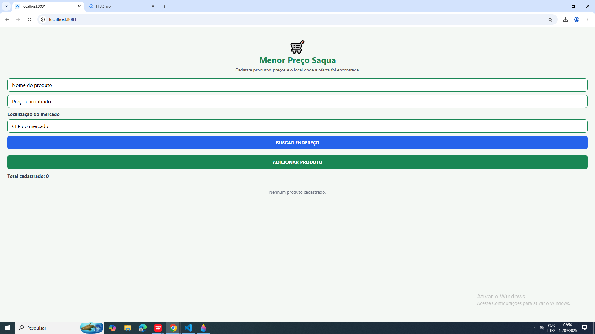

#### Endereço encontrado pela ViaCEP

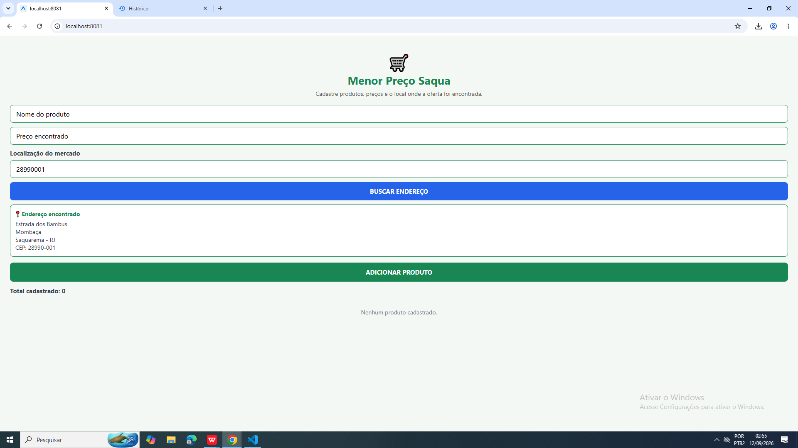

#### Produto cadastrado com localização

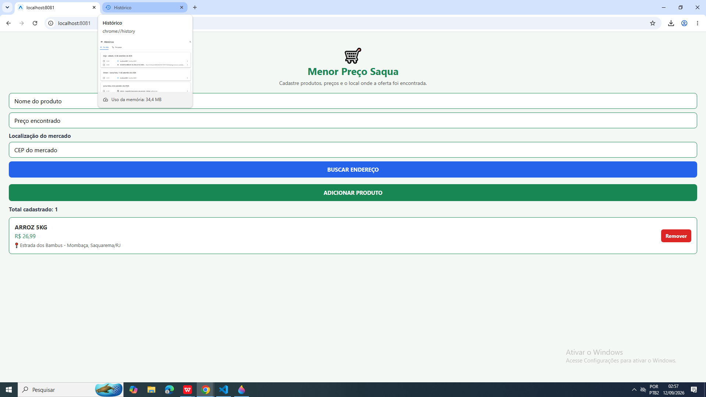

---

## Aula 6 — Persistência de Dados, Edição e Tratamento de Erros

Na Aula 6, o projeto **Menor Preço Saqua**  foi aprimorado com persistência local dos produtos cadastrados na versão Web da aplicação.

Os dados passaram a ser armazenados utilizando `localStorage`, permitindo que os produtos permaneçam cadastrados mesmo após a atualização da página.

Também foi implementada a edição dos produtos cadastrados, mantendo a funcionalidade de remoção e adicionando novos tratamentos e mensagens de retorno ao usuário.

### Funcionalidades implementadas

- Persistência dos produtos utilizando `localStorage`;

- Conversão dos dados utilizando `JSON.stringify`;

- Recuperação dos dados utilizando `JSON.parse`;

- Recuperação automática dos produtos ao iniciar a aplicação;

- Manutenção dos produtos após atualizar a página;

- Edição do nome e do preço dos produtos cadastrados;

- Remoção dos produtos cadastrados;

- Atualização dos dados persistidos após edição ou remoção;

- Validação dos campos obrigatórios;

- Tratamento de erros utilizando `try`, `catch` e `finally`;

- Mensagens de sucesso e erro para o usuário;

- Indicador de carregamento durante a consulta de CEP;

- Tratamento de falhas durante a consulta a API ViaCEP.

### Testes realizados

Durante os testes da Aula 6 foram verificados:

- Cadastro de produto com localização;

- Persistência do produto após atualizar a página;

- Edição do produto cadastrado;

- Persistência das alterações após atualizar a página;

- Remoção do produto;

- Persistência da remoção após atualizar a página;

- Validação dos campos obrigatórios;

- Consulta de endereço utilizando a API ViaCEP;

- Exibição das mensagens de sucesso e erro.

A persistência com `localStorage` é utilizada na versão Web do aplicativo. Posteriormente, para a entrega da P1, o projeto foi integrado a um backend próprio e a um banco de dados em nuvem.

---

### Prints da aplicação — Aula 6

#### Persistência dos dados após recarregar a página

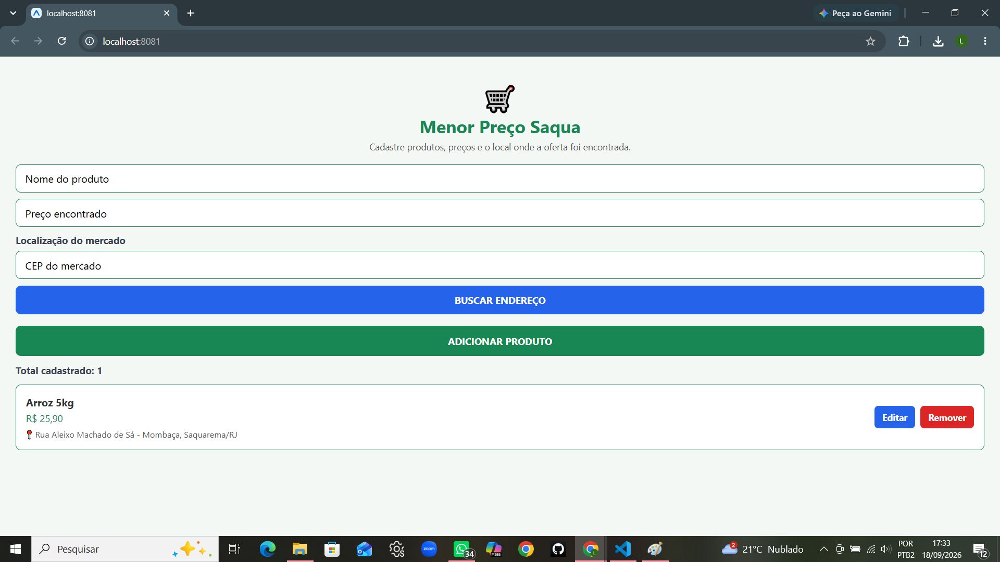

#### Produto cadastrado com opções de edição e remoção

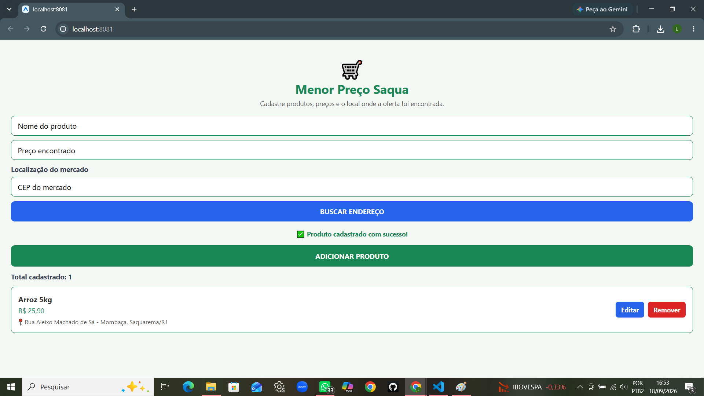

#### Edição de produto

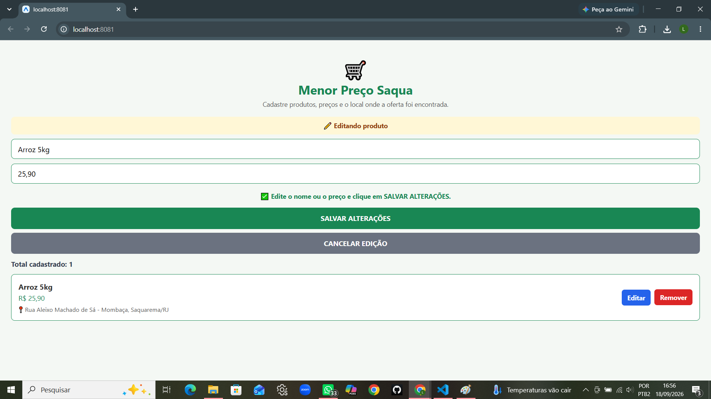

#### Produto atualizado

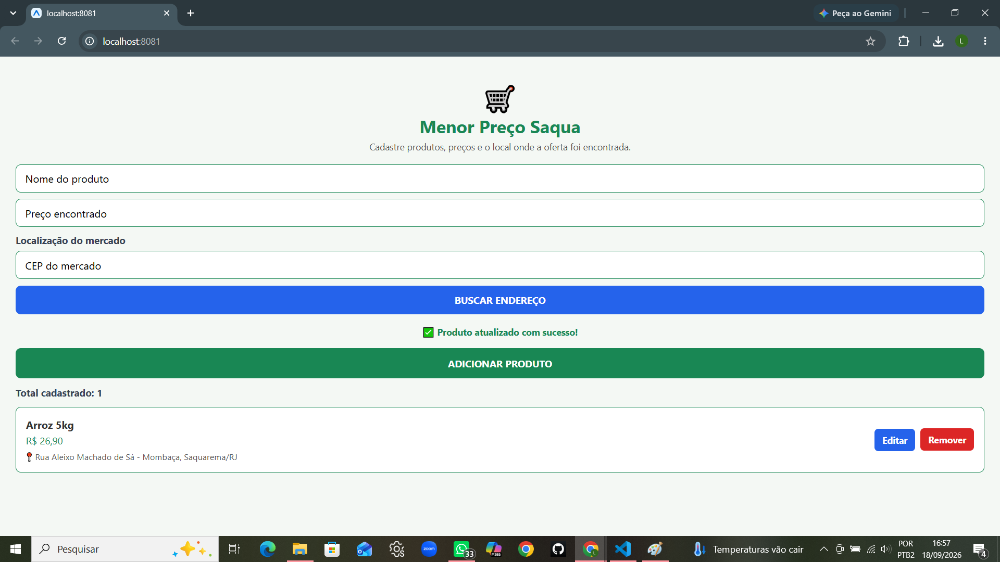

#### Validação dos campos obrigatórios

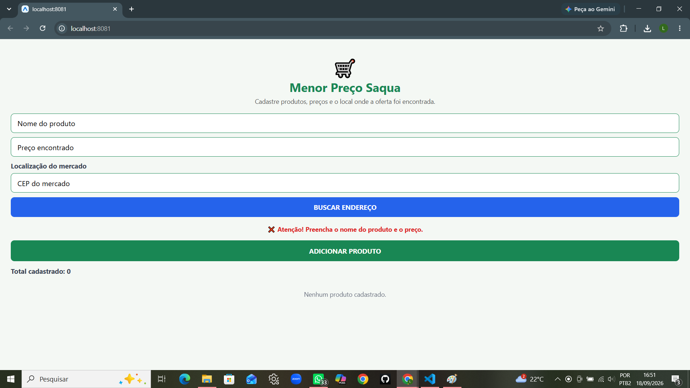

#### Remoção de produto

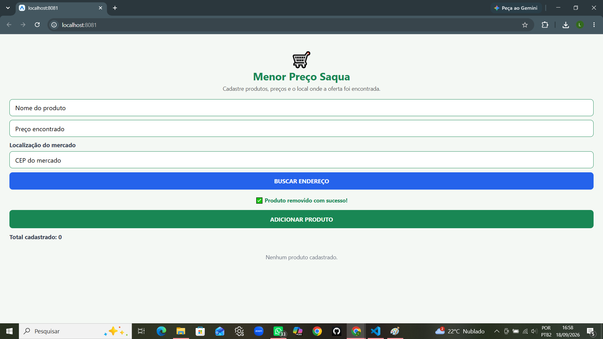

---

# P1 — Hospedagem do Projeto e Banco de Dados em Nuvem

Para a entrega da P1, o **Menor Preço Saqua** foi evoluído para uma arquitetura com frontend, backend e banco de dados em nuvem.

O frontend da aplicação foi publicado no **Vercel**, o backend desenvolvido com **Node.js e Express** foi hospedado no **Render** e a persistência dos produtos passou a ser realizada no **MongoDB Atlas**.

A aplicação também mantém a integração com a API **ViaCEP** para consulta do endereço do mercado a partir do CEP informado pelo usuário.

## Arquitetura da P1

```text

Usuário

Frontend — Expo / React Native Web

Vercel

API REST — Node.js / Express

Render

MongoDB Atlas

Banco de dados em nuvem

Frontend - ViaCEP

Consulta de endereço

```

## Backend e API REST

Para a P1 foi desenvolvido um backend utilizando Node.js, Express, Mongoose, CORS e Dotenv.

O backend recebe as requisições do frontend e realiza as operações de cadastro, consulta, edição e exclusão dos produtos no MongoDB Atlas.

### Operações CRUD

Operação - Método HTTP - Funcionalidade

Create - `POST` - Cadastrar um produto

Read - `GET` - Listar os produtos cadastrados

Update - `PUT` - Editar um produto

Delete - `DELETE` - Excluir um produto

### Endpoints

```text

GET    /produtos

POST   /produtos

PUT    /produtos/:id

DELETE /produtos/:id

```

## Banco de dados em nuvem

O **MongoDB Atlas** é utilizado para armazenar os produtos cadastrados. As operações realizadas pela interface são refletidas no banco de dados e os dados permanecem disponíveis mesmo após atualizar ou fechar a aplicação.

## Segurança das credenciais

A conexão utiliza a variável de ambiente `MONGODB_URI`. O arquivo `.env` não é enviado ao repositório público e as credenciais são configuradas por meio de variáveis de ambiente.

## Aplicação publicada

### Frontend — Vercel

https://gerenciador-de-mercado.vercel.app

### Backend — Render

https://menor-preco-saqua-api-8b8q.onrender.com

### Endpoint público de produtos

https://menor-preco-saqua-api-8b8q.onrender.com/produtos

## Testes realizados — P1

- Acesso pela URL pública;

- Comunicação entre frontend e backend;

- Comunicação entre backend e MongoDB Atlas;

- Consulta de endereço utilizando ViaCEP;

- Cadastro e recuperação de produtos;

- Persistência após atualizar a página;

- Edição e persistência da edição;

- Exclusão e persistência da exclusão;

- Sincronização das alterações com o MongoDB Atlas;

- Tratamento de erros e mensagens de retorno ao usuário.

Os testes de cadastro, consulta, edição e exclusão foram realizados com sucesso na aplicação publicada e as alterações foram confirmadas no MongoDB Atlas.

## Prints da aplicação — P1

#### Aplicação publicada no Vercel

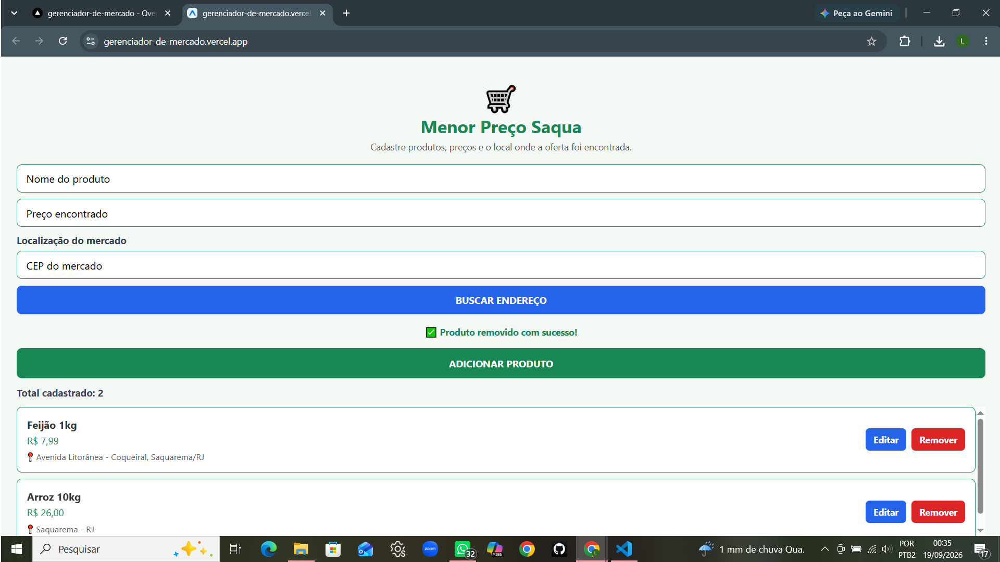

#### Backend publicado no Render

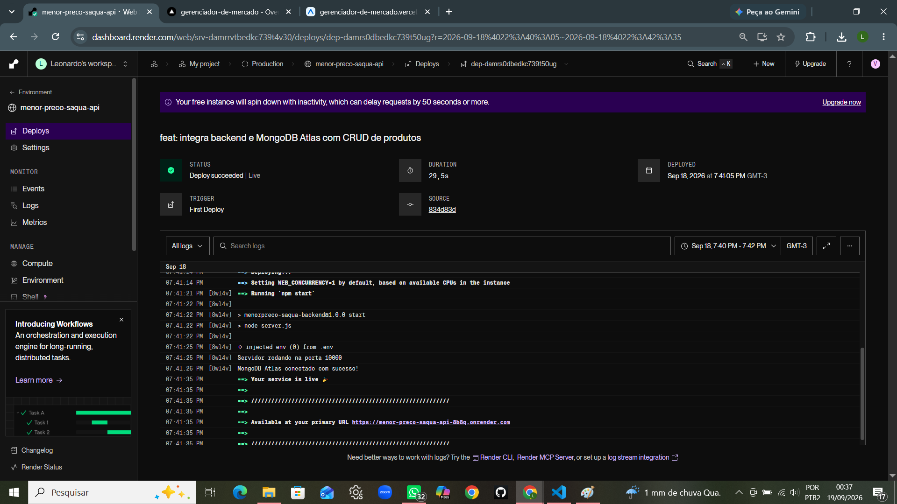

#### Produtos armazenados no MongoDB Atlas

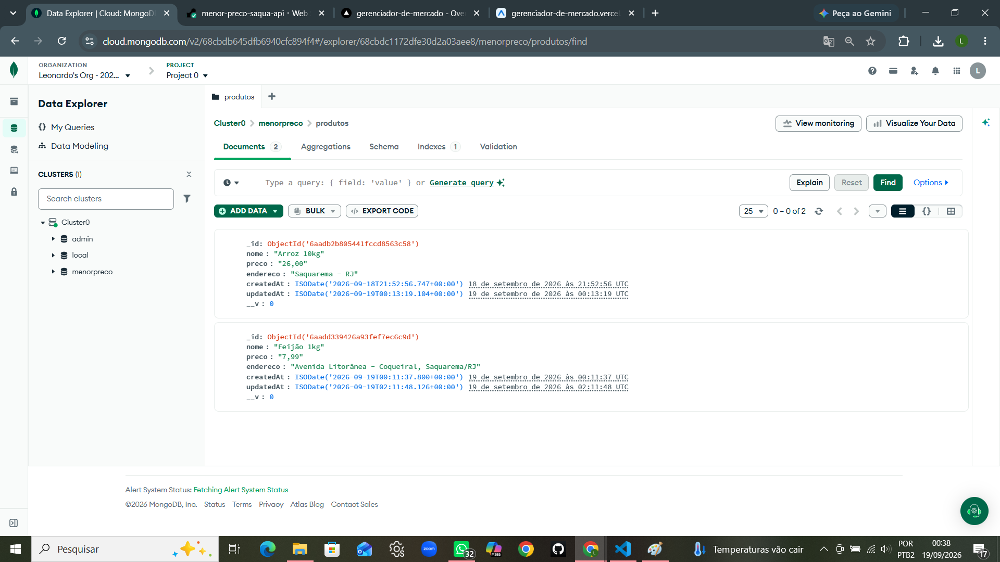

---

# Funcionalidades atuais

Atualmente, o Menor Preço Saqua possui:

- Cadastro do nome do produto;

- Cadastro do preço encontrado;

- Cadastro de vários produtos;

- Exibição dos produtos em lista;

- Contador de produtos cadastrados;

- Edição de produtos cadastrados;

- Remoção individual de produtos;

- Validação dos campos obrigatórios;

- Consulta de CEP;

- Busca automática do endereço do mercado;

- Integração com API REST;

- Processamento de dados JSON;

- Indicador de carregamento;

- Tratamento de erros;

- Mensagens de sucesso e erro;

- Exibição da localização associada ao produto;

- Persistência dos produtos utilizando `localStorage` na versão Web;

- Recuperação automática dos produtos após atualizar a página;

- Atualização dos dados persistidos após edição ou remoção;

- Backend próprio desenvolvido com Node.js e Express;

- API REST para gerenciamento dos produtos;

- Operações CRUD de cadastro, consulta, edição e exclusão;

- Persistência dos produtos no MongoDB Atlas;

- Backend hospedado no Render;

- Frontend publicado no Vercel;

- Aplicação disponível por URL pública.

Na Aula 6, o `localStorage` foi utilizado para demonstrar a persistência local na versão Web. Na P1, a aplicação passou a utilizar o MongoDB Atlas para persistência dos produtos em nuvem.

---

# Tecnologias utilizadas

- React Native;

- TypeScript;

- Expo;

- Expo Router;

- `fetch`;

- API REST;

- ViaCEP;

- Node.js;

- Express;

- Mongoose;

- MongoDB Atlas;

- CORS;

- Dotenv;

- Render;

- Vercel;

- Git;

- GitHub.

---

# Estrutura principal do projeto

```text

Gerenciador-de-mercado-final/

├── app/

│   ├── \_layout.tsx

│   └── (tabs)/

│       ├── \_layout.tsx

│       ├── index.tsx

│       └── acessibilidade.tsx

├── backend/

│   ├── models/

│   │   └── Produto.js

│   ├── package.json

│   ├── package-lock.json

│   └── server.js

├── src/

│   ├── components/

│   │   └── ProdutoItem.tsx

│   ├── screens/

│   │   └── CadastroProdutoScreen.tsx

│   └── services/

│       ├── produtosApi.ts

│       ├── viacep.ts

│       └── acessibilidade.ts

├── assets/

├── .gitignore

├── package.json

└── README.md

```

> O arquivo `backend/.env` existe apenas no ambiente local e não é enviado ao repositório público.

---

# Integrantes

- Heloísa Alice

- Rafael Farias

- Paulo Sérgio

- Leonardo Velloso

---

# P2 — Aula 1: Acessibilidade

A primeira atividade da P2 acrescentou recursos de acessibilidade à versão web do **Menor Preço Saqua**, preservando as operações de cadastro, consulta, edição e exclusão de produtos.

## Evidências da P2 — Aula 1: Acessibilidade

As imagens abaixo demonstram os recursos de acessibilidade

implementados no Menor Preço Saqua.

### 1. Tela de produtos — Modo claro

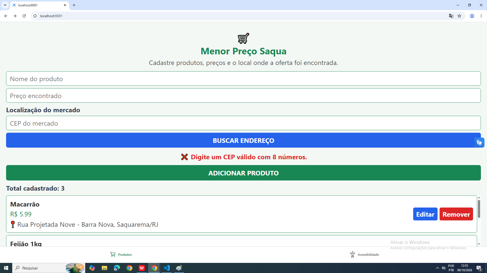

### 2. Tela de produtos — Modo escuro

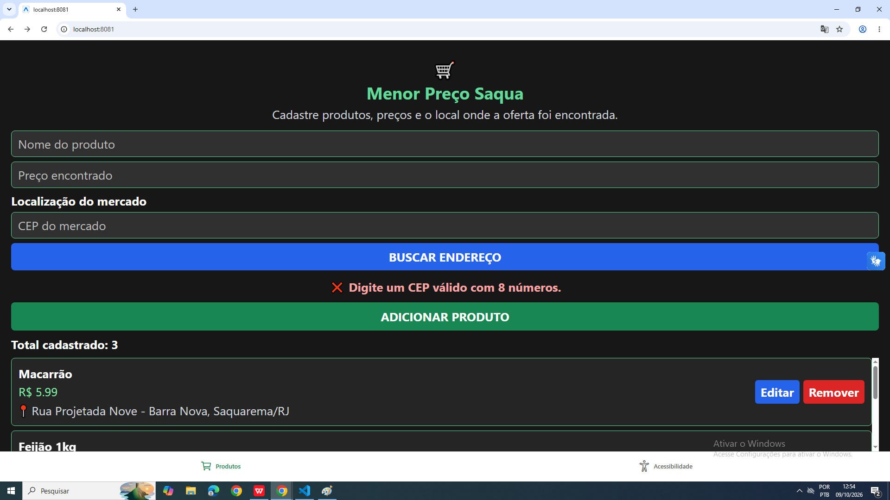

### 3. Aumento do tamanho da fonte

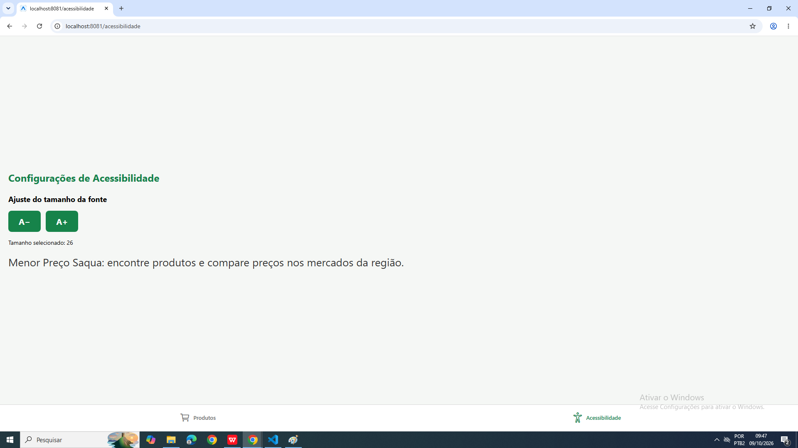

### 4. Redução do tamanho da fonte

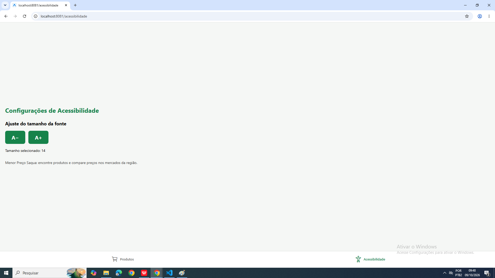

### 5. Persistência das preferências

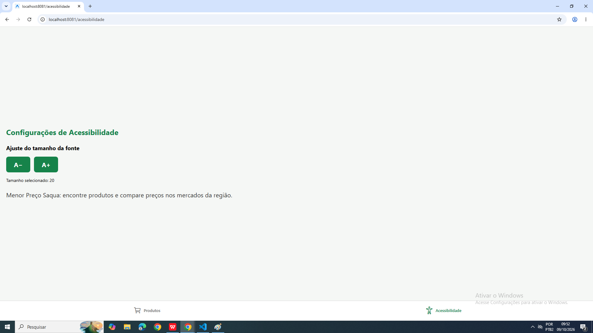

### 6. Integração com VLibras

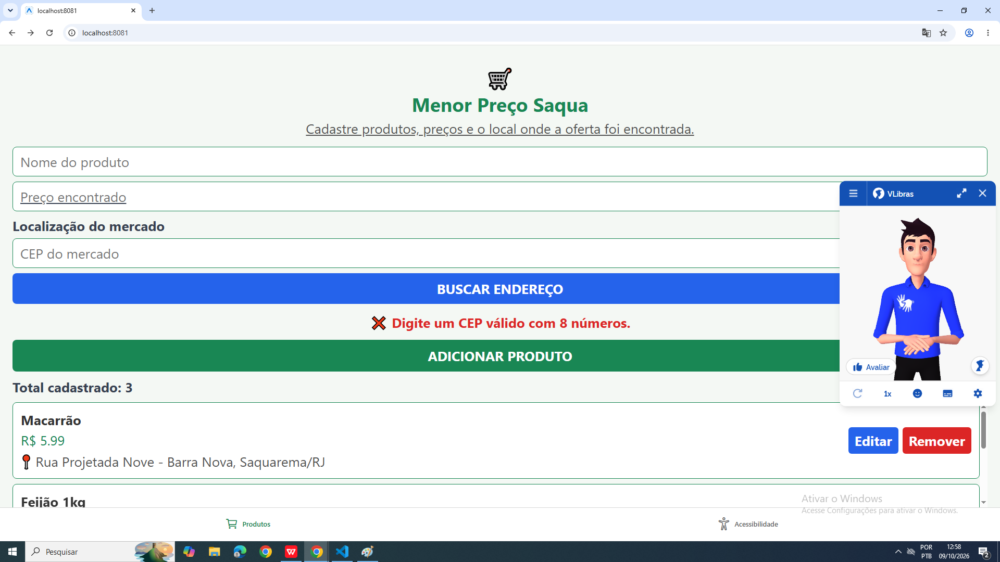

### 7. Evidência visual do recurso de Libras

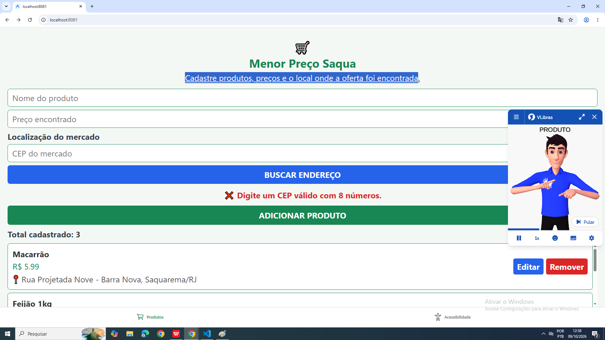

**Observação:** o leitor de tela do Windows foi testado

e aprovado, mas sua execução não é demonstrada

diretamente pela captura de tela.

## Funcionalidades implementadas

- **Tamanho de fonte ajustável:** controles na aba **Acessibilidade** permitem selecionar tamanhos de 14 a 26, aplicados à interface de produtos.

- **Tema claro e escuro:** opção para alternar a aparência do aplicativo.

- **Persistência das preferências:** o tema e o tamanho da fonte permanecem após atualizar a página, utilizando `localStorage` no navegador (chaves `menorpreco-tema` e `menorpreco-tamanho-fonte`).

- **Rótulos de acessibilidade:** identificação dos principais campos e botões para tecnologias assistivas.

- **VLibras:** integração do widget de tradução automática para Libras na versão web, disponível nas abas do aplicativo.

- **Navegação por teclado:** os controles principais foram testados com `Tab` e `Enter`.

### Arquivos envolvidos

- `app/\_layout.tsx` — integração web do VLibras.

- `app/(tabs)/\_layout.tsx` — navegação entre as abas.

- `app/(tabs)/acessibilidade.tsx` — configurações de tema e fonte.

- `src/services/acessibilidade.ts` — leitura das preferências salvas.

- `src/screens/CadastroProdutoScreen.tsx` — aplicação das preferências na tela de produtos.

- `src/components/ProdutoItem.tsx` — aparência acessível dos cartões de produtos.

## Validação da P2 — Aula 1

Foram realizados e aprovados **10 testes na versão web**, conforme execução e confirmação da equipe:

| Nº | Teste | Resultado |

|---|---|---|

| 1 | Alternar o tema claro/escuro nas duas abas | Aprovado |

| 2 | Aumentar a fonte até 26 sem cortes | Aprovado |

| 3 | Diminuir a fonte até 14 e verificar a legibilidade | Aprovado |

| 4 | Atualizar a página com F5 e manter as preferências | Aprovado |

| 5 | Cadastrar produto e consultar CEP | Aprovado |

| 6 | Editar produto cadastrado | Aprovado |

| 7 | Remover produto de teste | Aprovado |

| 8 | Navegar pelo teclado usando Tab e Enter | Aprovado |

| 9 | Abrir e utilizar o VLibras nas duas abas sem bloquear controles | Aprovado |

| 10 | Identificar os controles com o leitor de tela do Windows | Aprovado |

### Evidências visuais

Foram registradas sete capturas de tela para o relatório acadêmico, incluindo: tela de produtos no modo claro, modo escuro, controles de aumento e diminuição de fonte, persistência das preferências e VLibras em funcionamento. As capturas fazem parte do **relatório da P2 — Aula 1**; para exibi-las diretamente no GitHub, os arquivos de imagem precisam ser adicionados ao repositório e os caminhos referenciados aqui.

### Limitações conhecidas

- O VLibras realiza tradução automática e pode recorrer à **datilologia** (soletração manual) em algumas palavras; isso não garante tradução perfeita em todos os contextos.

- A persistência por `localStorage` e a integração do VLibras foram validadas na **versão web**. Esta seção registra os testes originais da Aula 1 na web. Testes posteriores de acessibilidade no Android estão documentados na seção P2 — Aula 7; ainda não foram registrados testes equivalentes em iOS.

- A presença de rótulos e a aprovação dos testes realizados não substituem uma auditoria completa de acessibilidade.

---

# P2 — Aula 9: Perfis e Sessão

## Objetivo

Implementar autenticação de usuários, gerenciamento de perfis e controle de sessões no aplicativo Menor Preço Saqua, utilizando Supabase Auth e políticas de segurança no banco de dados.

## Tecnologias utilizadas

- React Native e Expo Router

- TypeScript

- Supabase Authentication

- PostgreSQL e Row Level Security (RLS)

- AsyncStorage para armazenamento de preferências locais

## Funcionalidades implementadas

- Login de usuários cadastrados no Supabase.

- Identificação do usuário autenticado.

- Visualização dos dados do próprio perfil.

- Edição do nome do usuário.

- Separação dos dados de perfil entre diferentes contas.

- Encerramento manual da sessão (logout).

- Expiração automática por inatividade.

- Restrição de acesso aos perfis por meio de políticas RLS.

## Segurança e controle de sessão

A autenticação é realizada pelo Supabase Auth.

A tabela `profiles` armazena os dados dos perfis, enquanto a tabela `session_leases` auxilia no controle de sessões ativas.

As políticas RLS restringem a consulta e a atualização dos perfis ao usuário autenticado com sessão válida.

O controle de inatividade foi testado com um intervalo de aproximadamente 2 minutos.

## Testes realizados

| Nº | Teste | Resultado |

|---|---|---|

| 1 | Login do Aluno A | Aprovado |

| 2 | Visualização do perfil do Aluno A | Aprovado |

| 3 | Alteração do nome do usuário | Aprovado |

| 4 | Logout e retorno à tela de login | Aprovado |

| 5 | Login do Aluno B e separação dos perfis | Aprovado |

| 6 | Expiração da sessão por inatividade | Aprovado |

| 7 | Bloqueio de leitura sem sessão ativa via RLS | Aprovado |

| 8 | Bloqueio de atualização sem sessão ativa via RLS | Aprovado |

## Evidências visuais — Aula 9

### 1. Tela de login

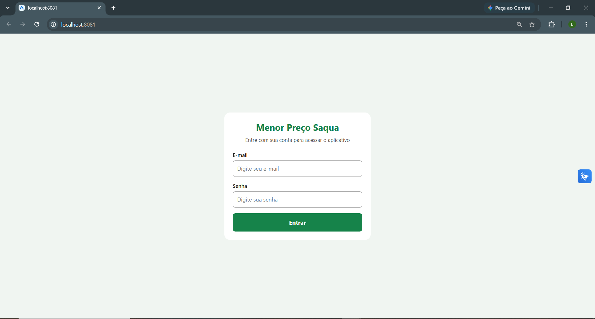

### 2. Perfil do Aluno A

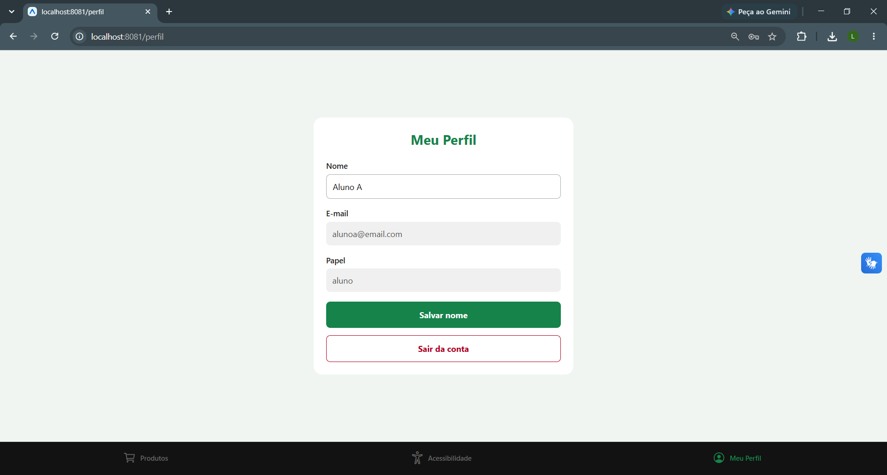

### 3. Edição do perfil

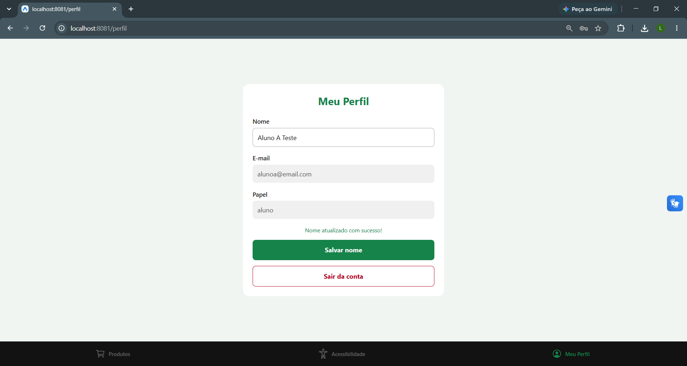

### 4. Perfil do Aluno B


### 5. Logout

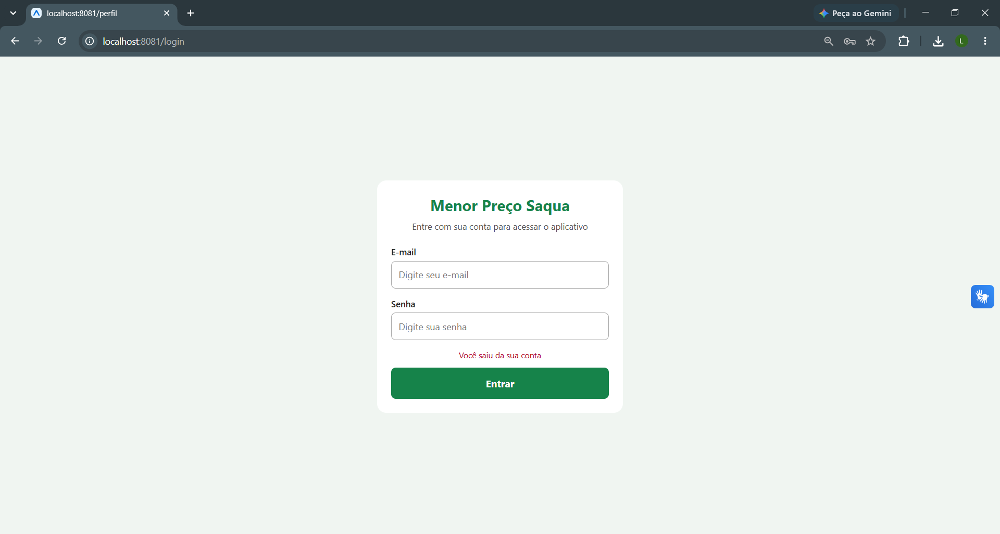

### 6. Expiração automática da sessão

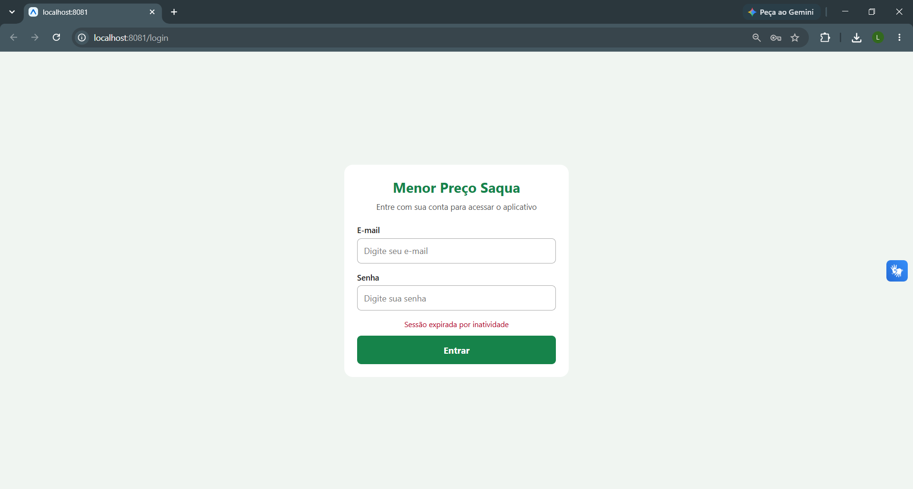

### 7. Segurança com RLS

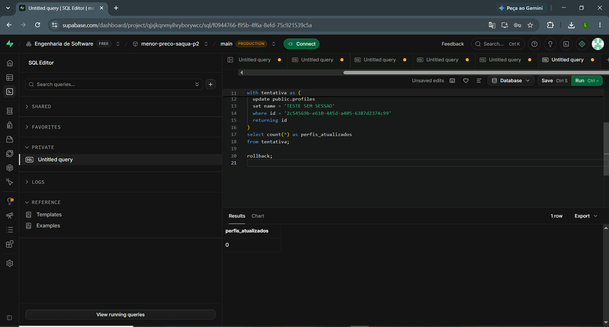

O teste de atualização sem sessão válida retornou `perfis_atualizados = 0`, demonstrando o bloqueio da operação no cenário avaliado.

## Evidências de testes no Android — Aula 9

Os testes foram realizados em um dispositivo Android utilizando o Expo Go compatível com o SDK 54.

### 1. Login no Android

O aplicativo permitiu a autenticação e exibiu a tela principal com os produtos cadastrados.

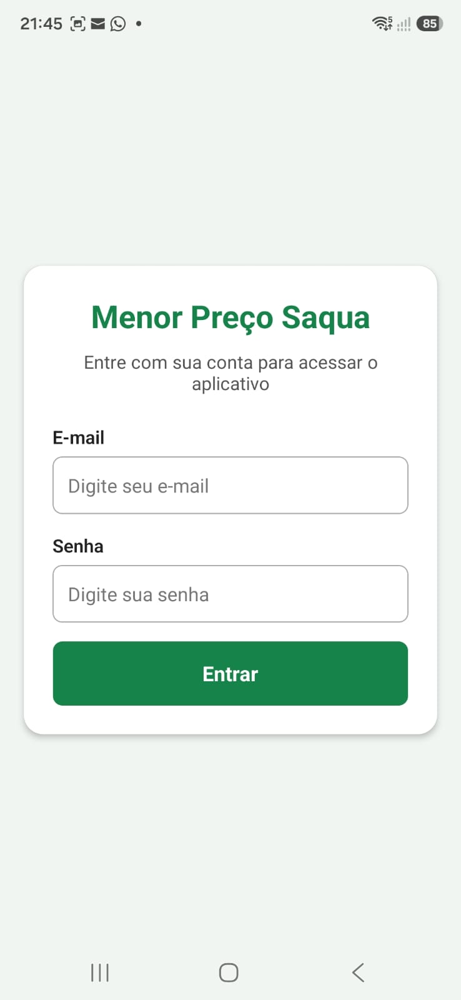

### 2. Expiração por inatividade

Após aproximadamente 2 minutos sem interação, a sessão foi encerrada automaticamente e o aplicativo retornou à tela de login.

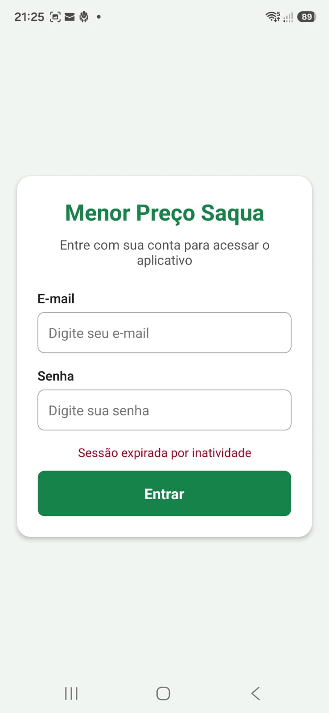

### 3. Encerramento ao sair do primeiro plano

Ao sair do aplicativo para utilizar outro e retornar, foi exigida uma nova autenticação.

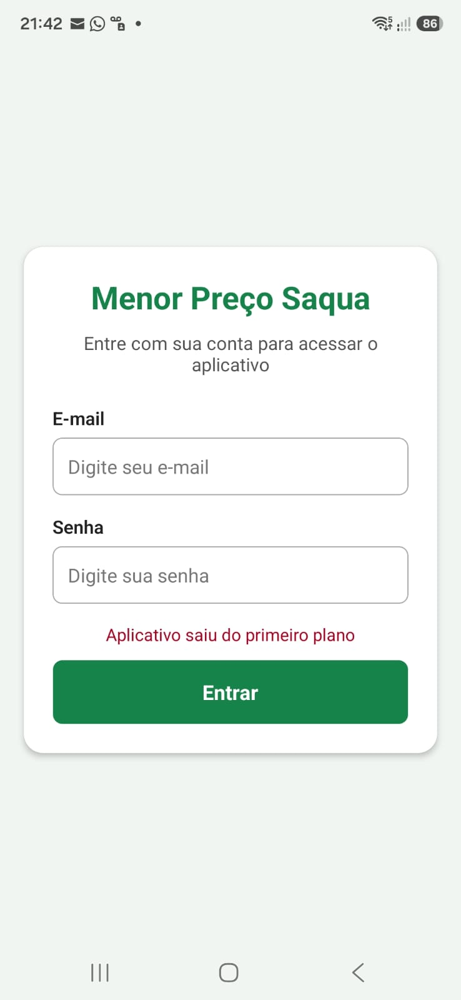

### 4. Fechamento e reabertura

Após fechar o Expo Go e reabrir o projeto, a sessão anterior não foi restaurada automaticamente no cenário testado.


### 5. Perfil do Aluno A

O aplicativo exibiu os dados associados à conta do Aluno A.

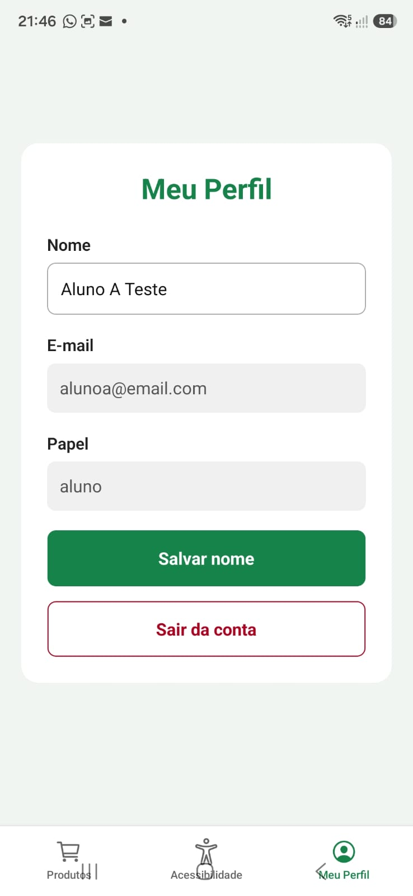

### 6. Logout

O encerramento manual da sessão retornou o aplicativo à tela de autenticação.

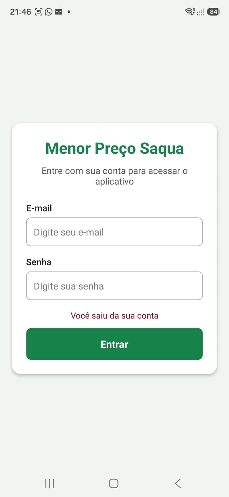

### 7. Perfil do Aluno B

Após o logout do Aluno A e o login do Aluno B, foram exibidos os dados da segunda conta, sem apresentar os dados pessoais do usuário anterior.

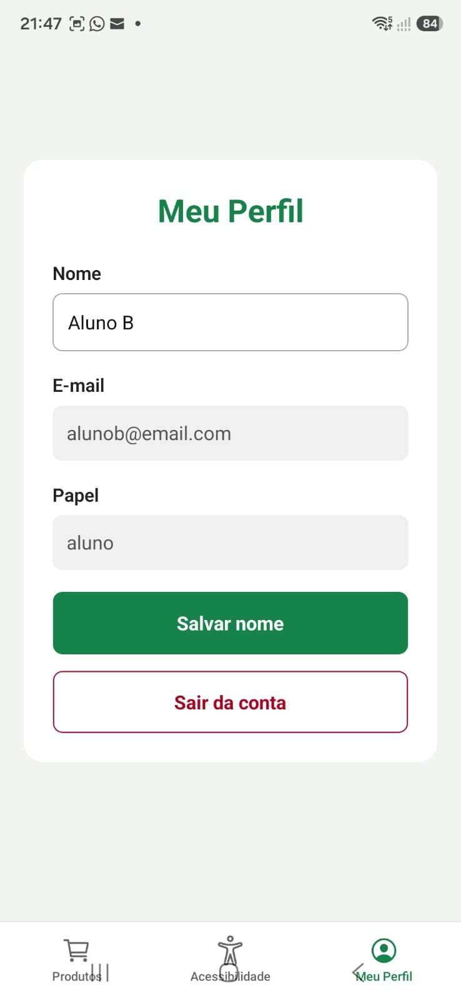

### Resultado dos testes no Android

| Teste | Resultado |

|---|---|

| Login e acesso à tela principal | Aprovado |

| Expiração após aproximadamente 2 minutos | Aprovado |

| Encerramento ao sair do primeiro plano | Aprovado |

| Fechamento e reabertura do Expo Go | Aprovado |

| Visualização do perfil do Aluno A | Aprovado |

| Logout do Aluno A | Aprovado |

| Login do Aluno B e separação dos perfis | Aprovado |

**Observação:** os testes foram executados no Expo Go em Android. Posteriormente, na P2 — Aula 10, o login e a expiração por inatividade também foram validados em APK Android independente.

## Arquivos principais

- `app/login.tsx` — tela de autenticação.

- `app/(tabs)/perfil.tsx` — visualização e edição do perfil.

- `src/contexts/SessionProvider.tsx` — gerenciamento da sessão.

- `src/services/supabase.ts` — configuração do cliente Supabase.

- `app/\_layout.tsx` — integração do contexto de sessão.

- `app/(tabs)/\_layout.tsx` — navegação entre as abas.

## Limitações e observações

- Os testes funcionais da Aula 9 foram realizados na versão web e em um dispositivo Android utilizando o Expo Go compatível com o SDK 54.

- No Android, foram validados login, visualização de perfis, logout, expiração por inatividade, encerramento ao sair do primeiro plano e reabertura sem restauração automática da sessão.

- A versão independente do Android foi validada posteriormente na P2 — Aula 10 para login e expiração por inatividade; consulte a seção correspondente.

- Ainda não foram realizados testes equivalentes em dispositivos iOS.

- A configuração `persistSession: false` impede a persistência automática da sessão de autenticação pelo cliente Supabase.

- O AsyncStorage é utilizado para armazenar preferências locais, como a configuração de autenticação biométrica.

- As credenciais de configuração são mantidas fora do repositório por meio do arquivo `.env`.

- As políticas RLS restringem o acesso aos dados e devem continuar sendo verificadas em futuras alterações.

---

# P2 — Aula 7: Revisão Final e Evidências de Acessibilidade

## Objetivo

Realizar a revisão final dos recursos de acessibilidade do aplicativo Menor Preço Saqua, verificando a aplicação global do tema, o ajuste do tamanho da fonte e a persistência das preferências no Android.

## Versão do aplicativo

- Aplicativo: Menor Preço Saqua

- Versão: 1.0.0

- Expo SDK: 54

- Linguagem: TypeScript

- Branch: main

- Commit de referência: d780208

## Evidências visuais — Aula 7

### A7-01 — Tela de Produtos no modo claro

Demonstração da interface de produtos com o tema claro.

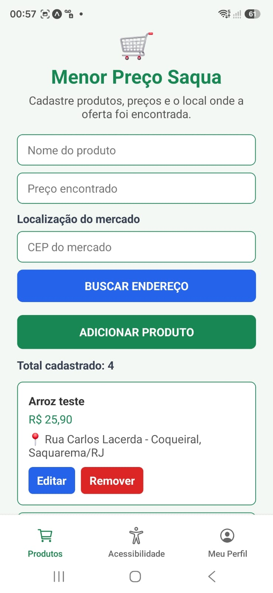

### A7-02 — Tela de Produtos no modo escuro

Demonstração da aplicação do tema escuro na tela de produtos.

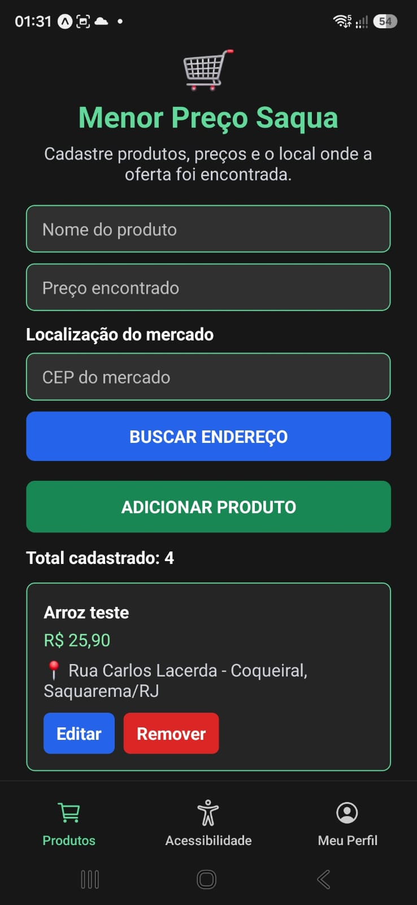

### A7-03 — Acessibilidade com fonte ampliada

Demonstração da configuração do tamanho da fonte para 26.


### A7-04 — Meu Perfil no modo escuro

Demonstração da aplicação das preferências de acessibilidade na tela Meu Perfil.

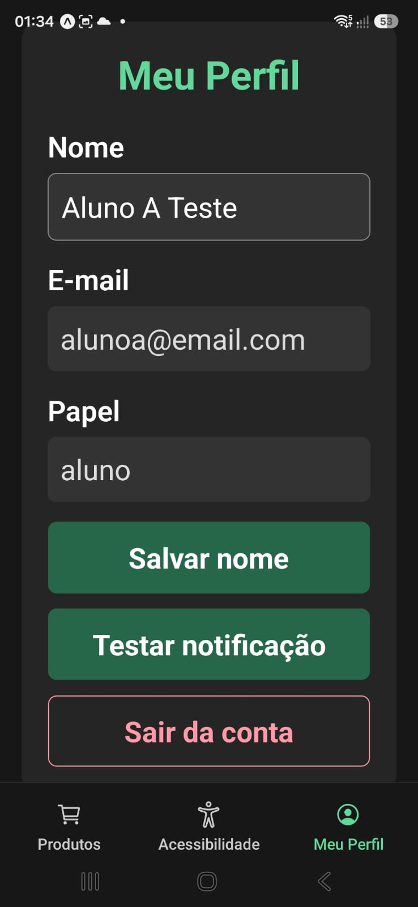

### A7-05 — Persistência das preferências

Verificação da manutenção do tema escuro e da fonte 26 após fechar e reabrir o aplicativo no Expo Go.

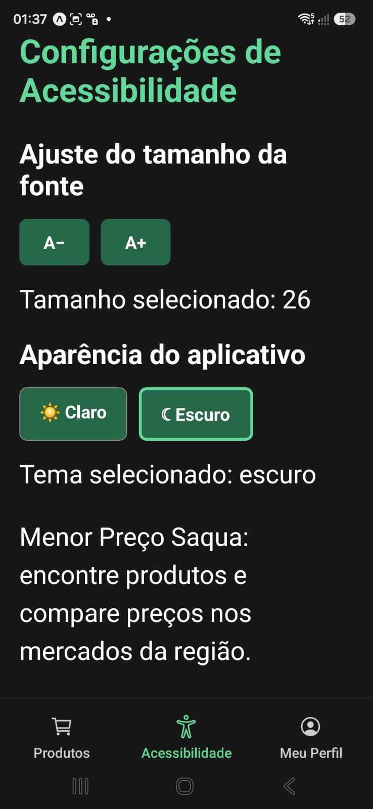

## Resultado parcial da revisão

As evidências registram a aplicação das configurações de acessibilidade em diferentes telas e a persistência das preferências no cenário testado.

Os testes integrados, de segurança e os demais requisitos da revisão final serão documentados conforme sua execução.

# P2 — Aula 10: Entrada com Recurso Nativo (Biometria)

## Objetivo

Integrar a autenticação biométrica disponibilizada pelo sistema operacional ao login remoto com Supabase, permitindo ativar ou desativar a entrada nativa por conta e aparelho, sem armazenar senhas nem capturar impressões digitais ou imagens faciais diretamente.

> O material fornecido pelo professor identifica esta atividade como “Aula 3 — P2: Entrada com Recurso Nativo”. A equipe registra a implementação nesta seção como Aula 10, de acordo com a sequência utilizada no projeto.

## Funcionalidades implementadas

- Login remoto por e-mail e senha com Supabase Auth.
- Ativação e desativação da biometria no perfil.
- Preferência local de entrada nativa separada por conta e aparelho.
- Verificação da disponibilidade da biometria e uso do diálogo nativo do Android.
- Tratamento de confirmação, cancelamento e indisponibilidade sem liberar acesso indevido.
- Controle remoto da sessão com `begin_session` e `touch_session`.
- Encerramento da sessão após aproximadamente 2 minutos sem interação.
- Geração e instalação de APK Android independente com EAS Build.

## Arquivos principais

- `app/(tabs)/perfil.tsx` — perfil e ativação/desativação da biometria.
- `src/contexts/SessionProvider.tsx` — autenticação e ciclo de vida da sessão.
- `src/services/supabase.ts` — integração com Supabase.
- `app.json` — configurações nativas do aplicativo.
- `eas.json` — perfil de build Android `preview`.

## Configuração e execução

Pré-requisitos: Node.js, npm e projeto Supabase configurado. Configure localmente o arquivo `.env` (não versionado):

```dotenv
EXPO_PUBLIC_SUPABASE_URL=https://SEU-PROJETO.supabase.co
EXPO_PUBLIC_SUPABASE_ANON_KEY=SUA_CHAVE_PUBLICAVEL
```

Para instalar dependências e iniciar o projeto:

```bash
npm install
npx expo start
```

Para compilar o APK Android de teste:

```bash
npx eas-cli build --platform android --profile preview
```

As variáveis `EXPO_PUBLIC_SUPABASE_URL` e `EXPO_PUBLIC_SUPABASE_ANON_KEY` também devem estar configuradas no ambiente `preview` do EAS. Não versionar `.env`, senhas, tokens de sessão ou chaves secretas de serviço. A chave publicável é uma configuração de cliente, não uma chave de serviço privilegiada.

## Testes realizados no Android

| Nº | Cenário | Resultado |
|---|---|---|
| 1 | Tela de login remoto | Aprovado |
| 2 | Perfil com opção de ativar biometria | Aprovado |
| 3 | Ativação da biometria | Aprovado |
| 4 | Exibição do diálogo nativo de autenticação | Aprovado |
| 5 | Acesso à tela de produtos após confirmação | Aprovado |
| 6 | Cancelamento mantém a entrada bloqueada | Aprovado |
| 7 | Desativação da biometria | Aprovado |
| 8 | Expiração após aproximadamente 2 minutos sem interação | Aprovado |
| 9 | Biometria indisponível impede acesso | Aprovado |
| 10 | Troca de aplicativo durante confirmação não libera acesso | Aprovado |
| 11 | Preferência da conta A não aplicada automaticamente à conta B | Aprovado |

Os 11 cenários acima foram documentados com capturas fornecidas durante a validação no Android. O login remoto e a expiração por inatividade foram confirmados também no APK instalado independentemente do Expo Go. A verificação de TypeScript com `npx tsc --noEmit` terminou sem erros. A disponibilidade de métodos alternativos, como PIN, depende do dispositivo e do sistema operacional.

## Prints e evidências — Aula 10

As imagens estão organizadas na pasta `docs/imagens/aula10/`. Os caminhos abaixo são relativos à raiz do repositório e serão exibidos no GitHub quando o README e os arquivos de imagem forem enviados juntos.

### 1. Tela de login

Tela de autenticação por e-mail e senha.

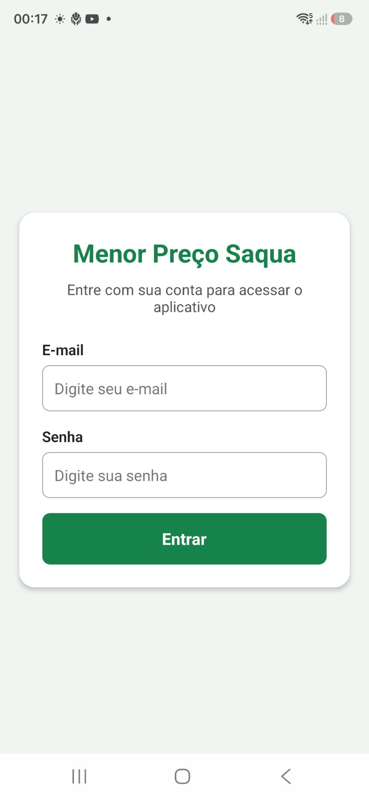

### 2. Perfil do usuário

Perfil da conta de teste com opção de ativar biometria.

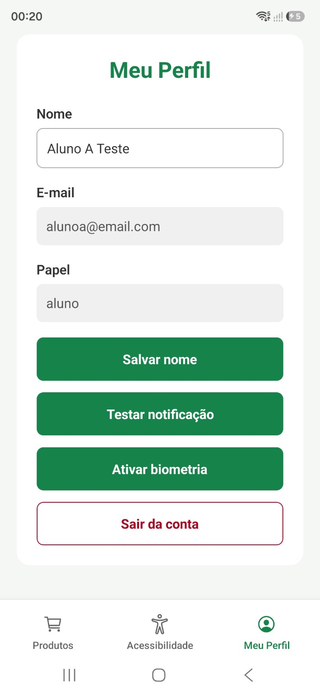

### 3. Ativação da biometria

Mensagem de confirmação e opção de desativar biometria.

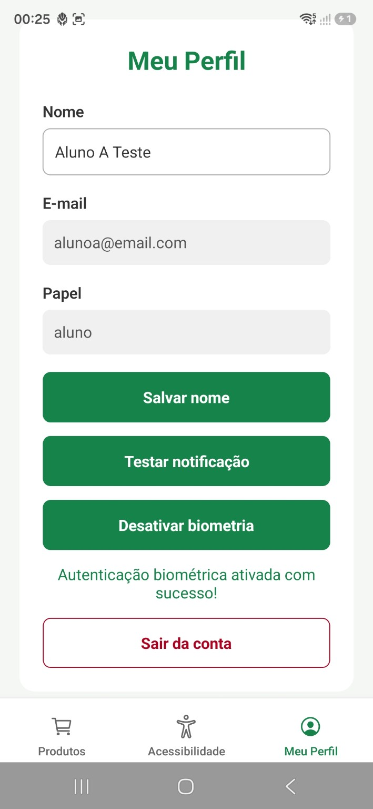

### 4. Diálogo nativo do Android

Solicitação de autenticação pelo sistema operacional e opção de PIN.


### 5. Acesso após autenticação biométrica

Tela de produtos acessível após confirmação biométrica.

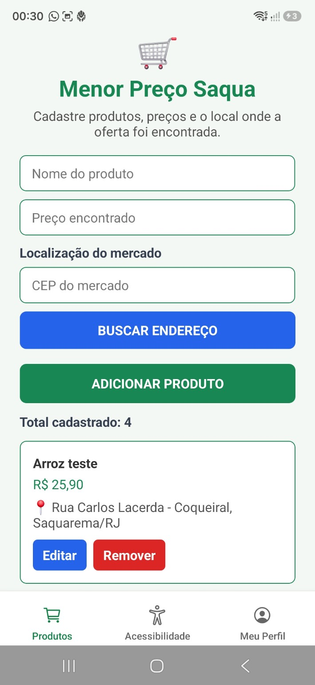

### 6. Cancelamento do diálogo

Mensagem de entrada não autorizada e permanência no login.

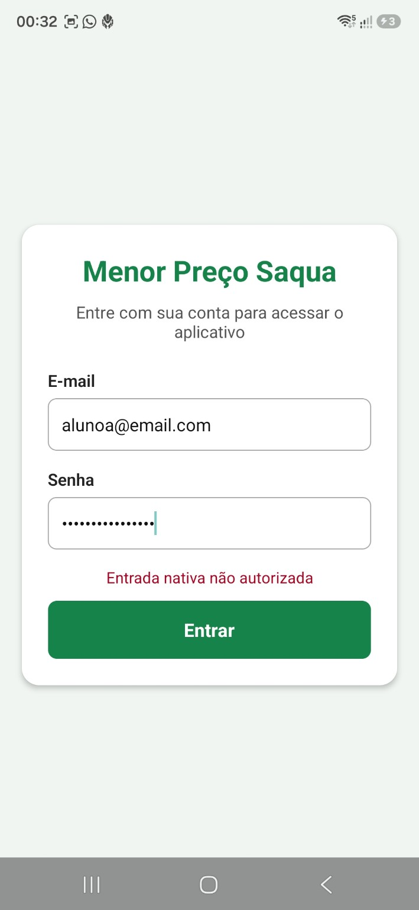

### 7. Desativação da biometria

Confirmação da desativação no perfil.

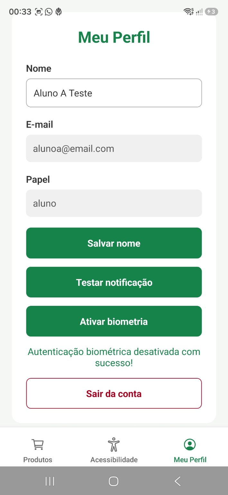

### 8. Expiração da sessão

Retorno ao login após inatividade.

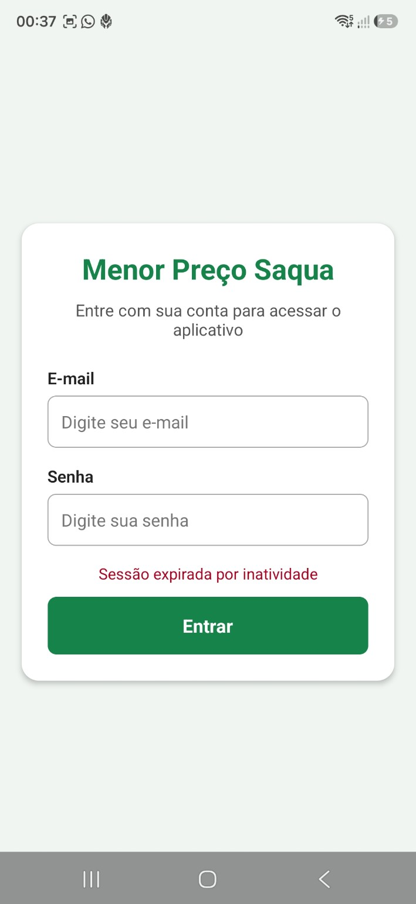

### 9. Biometria indisponível

Mensagem de indisponibilidade e acesso não liberado.

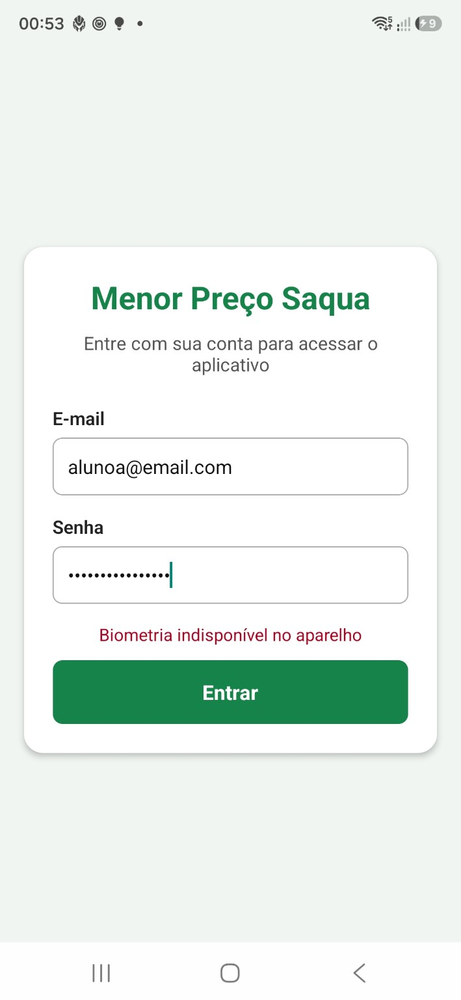

### 10. Troca de aplicativo durante confirmação

Retorno ao login com entrada não autorizada.

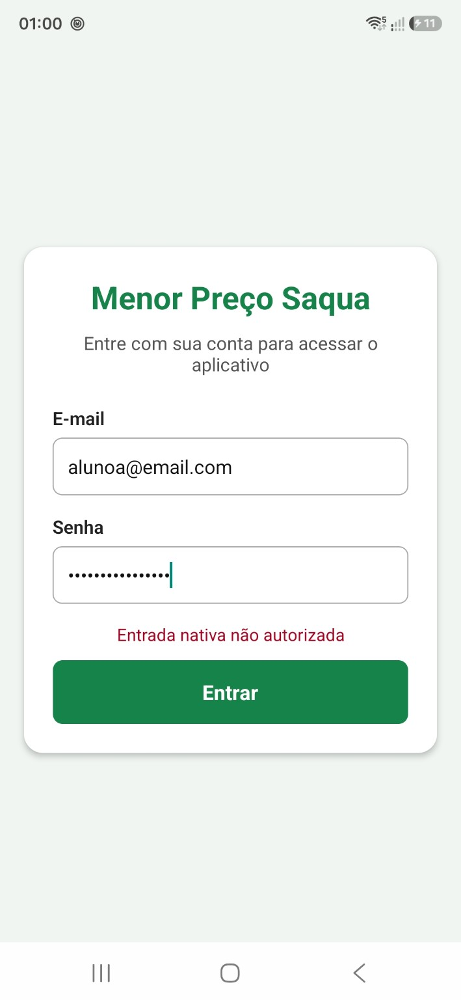

### 11. Preferência isolada entre contas

Conta B com opção Ativar biometria, sem herdar a preferência da conta A.

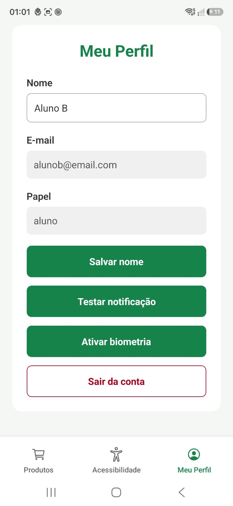

## Build Android e repositório

- **APK Android:** [Build concluída no Expo](https://expo.dev/accounts/leovelloso/projects/menorpreco-saqua/builds/0ff11fdc-c8bf-4282-8cd0-399c727838b0).
- **Código-fonte:** [Repositório Gerenciador-de-mercado](https://github.com/Sergio003/Gerenciador-de-mercado).
- **Branch:** `main`.
- **Commit da implementação:** `0924647` — `Aula 10: autenticacao, biometria e controle de sessao`.

## Limitações

- Não foram realizados testes em dispositivo iOS com Face ID.
- Os resultados são relativos aos aparelhos e cenários efetivamente testados; não substituem validação em outros dispositivos e versões do sistema.
- As capturas devem ser revisadas antes da publicação para evitar exposição de dados pessoais.

---

# Status

**P1 concluída. P2 — Aulas 1, 7, 9 e 10 documentadas, com testes na web, no Expo Go e no APK Android independente.**

O Menor Preço Saqua possui uma versão web publicada, integrada a uma API REST própria e ao MongoDB Atlas para persistência dos produtos em nuvem.

Na P2, foram acrescentados recursos de acessibilidade, autenticação com Supabase, gerenciamento de perfis e controle de sessões.

A Aula 9 foi validada por testes funcionais de login, visualização e edição de perfil, logout, expiração por inatividade e verificações de segurança RLS.

No Android, utilizando o Expo Go compatível com o SDK 54, foram realizados testes de login, visualização dos perfis dos Alunos A e B, logout, expiração após aproximadamente 2 minutos, encerramento ao sair do primeiro plano e reabertura sem restauração automática. Na Aula 10, login e expiração por inatividade foram confirmados também no APK independente.

As evidências estão disponíveis nas seções **P2 — Aula 9: Perfis e Sessão** e **P2 — Aula 10: Entrada com Recurso Nativo** deste README.

**Pendência de validação:** testes equivalentes em dispositivos iOS. A versão Android independente já foi validada para login e expiração por inatividade, com evidências adicionais de biometria na Aula 10.

---

# Histórico de desenvolvimento

Etapa - Desenvolvimento

Aulas 2 e 3 - Definição do problema, proposta e desenvolvimento do primeiro MVP

Aula 4 - `useState`, `TextInput`, validações, `FlatList`, remoção e componente reutilizável

Aula 5 - Integração com API REST ViaCEP, requisição `GET`, JSON, loading e tratamento de erros

Aula 6 - Persistência com `localStorage`, recuperação automática dos dados, edição, remoção e tratamento de erros

P1 - Backend Node.js/Express, CRUD, MongoDB Atlas, hospedagem no Render e publicação do frontend no Vercel

P2 — Aula 1: Implementação de recursos de acessibilidade, incluindo tema claro e escuro, ajuste do tamanho da fonte, persistência das preferências, navegação por teclado, suporte a leitor de tela e integração com VLibras.

P2 — Aula 9: Implementação de autenticação com Supabase Auth, gerenciamento de perfis, edição de dados, logout, expiração de sessão por inatividade e políticas de segurança RLS.

P2 — Aula 7: Revisão de acessibilidade no Android, com evidências de tema claro e escuro, fonte ampliada e persistência das preferências.

P2 — Aula 10: Integração da autenticação biométrica ao login remoto, controle de sessão, geração e testes de APK Android independente.

---

# Próximas etapas

Após a conclusão da P1 e o desenvolvimento das atividades da P2, o projeto Menor Preço Saqua continuará evoluindo conforme as atividades propostas na disciplina.

As próximas atividades incluem:

- Conferir os requisitos oficiais da Aula 7 e identificar possíveis pendências da revisão final.

- Ampliar os testes no APK Android independente e validar em iOS, quando aplicável.

- Realizar testes adicionais de autenticação e controle de sessão.

- Manter a documentação e as evidências atualizadas no GitHub.

- Preservar as funcionalidades de cadastro, consulta, edição e exclusão de produtos.
